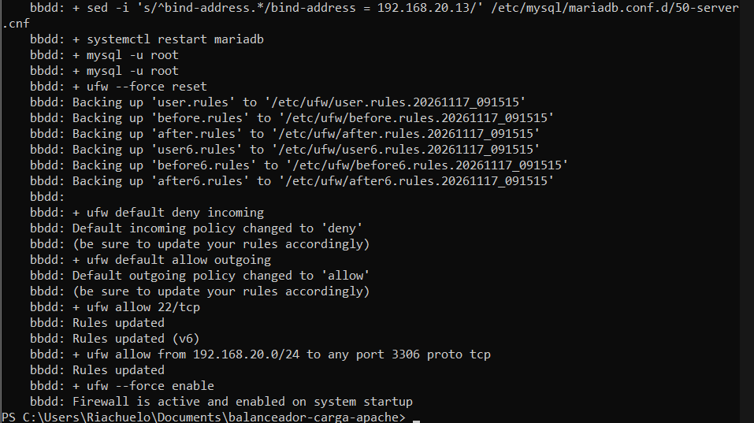
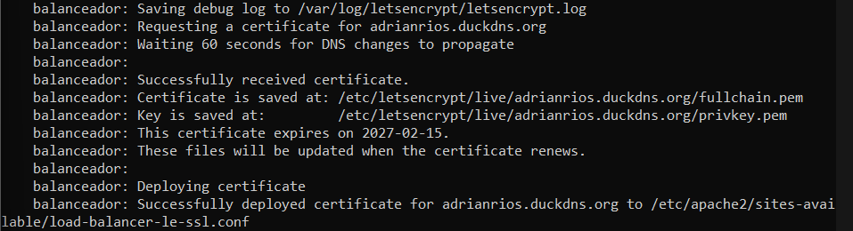
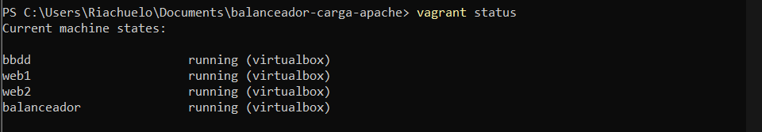
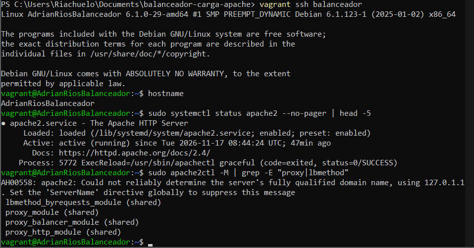
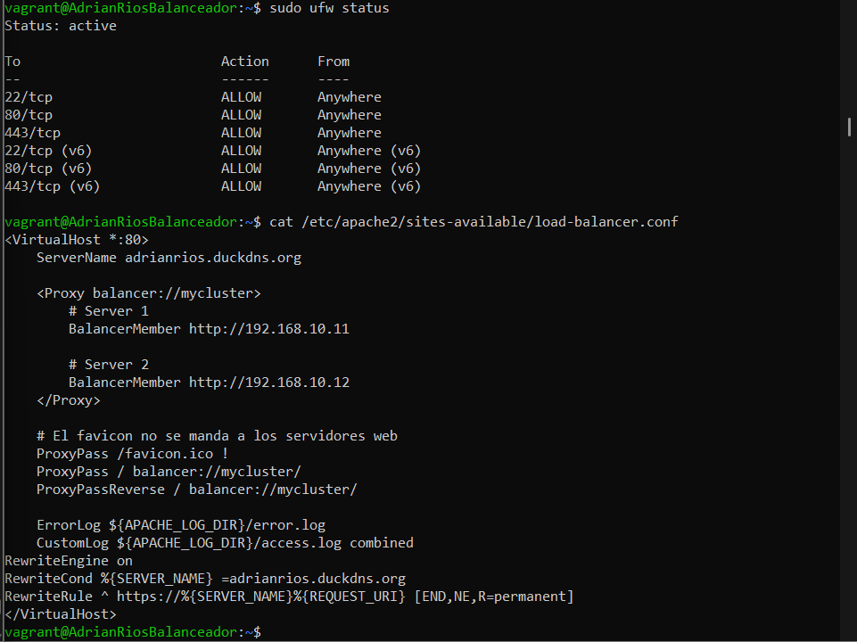
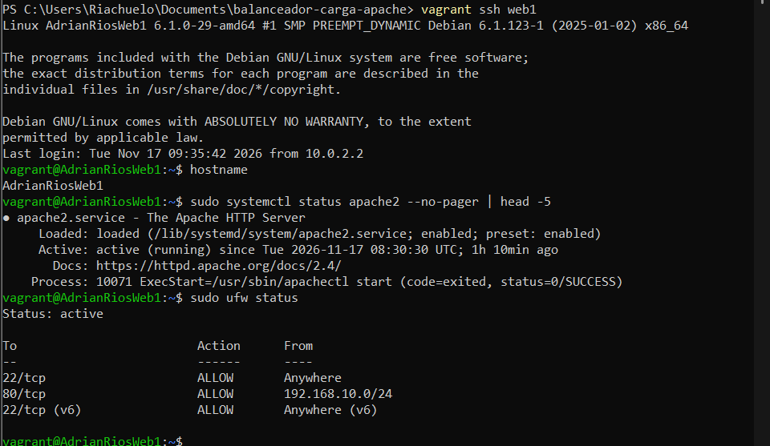
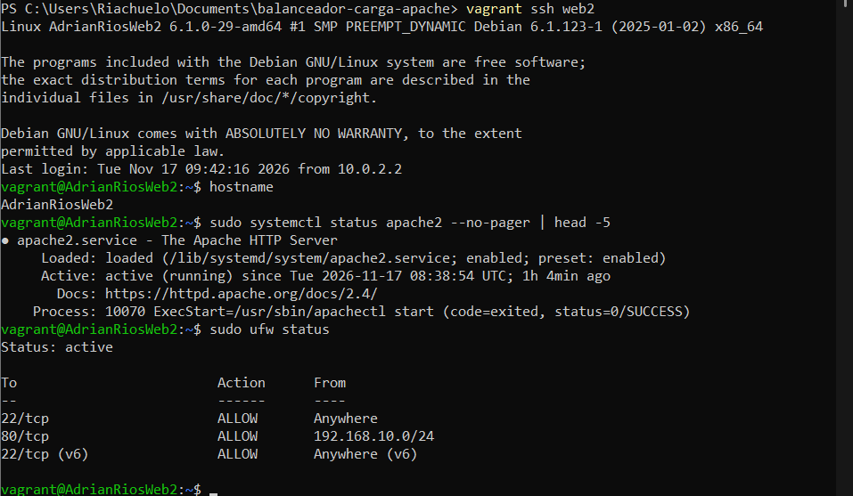
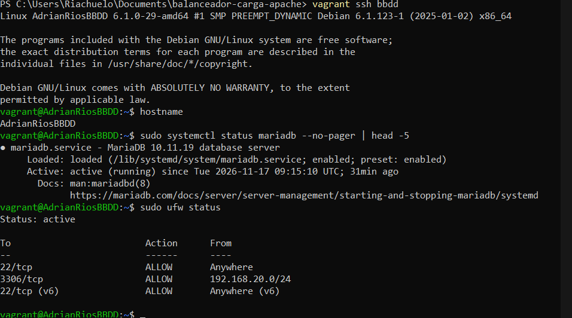
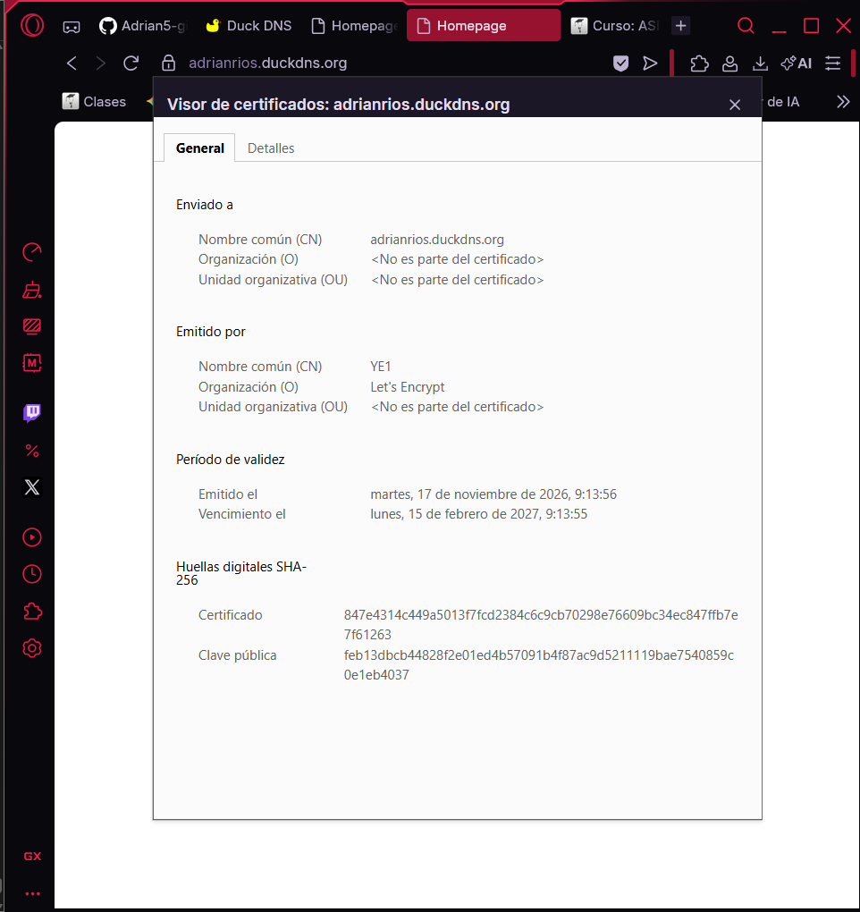
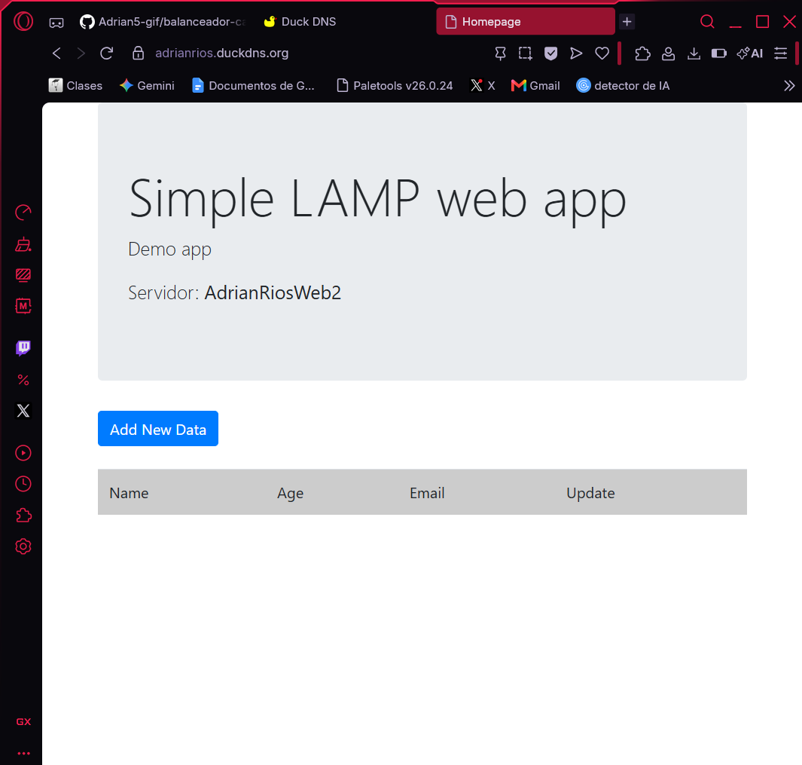

# Balanceador de carga con Apache en tres niveles

Práctica de Implantación de Aplicaciones Web (2º ASIR)
Adrián Ríos Mendoza

Web: https://adrianrios.duckdns.org

## Índice

1. [Introducción](#1-introducción)
2. [Cómo es la infraestructura](#2-cómo-es-la-infraestructura)
3. [AWS y máquinas virtuales](#3-aws-y-máquinas-virtuales)
4. [Ficheros del repositorio](#4-ficheros-del-repositorio)
5. [Vagrantfile](#5-vagrantfile)
6. [Base de datos](#6-base-de-datos)
7. [Servidores web](#7-servidores-web)
8. [Balanceador](#8-balanceador)
9. [Certificado HTTPS](#9-certificado-https)
10. [Cortafuegos](#10-cortafuegos)
11. [Cómo ponerlo en marcha](#11-cómo-ponerlo-en-marcha)
12. [Comprobaciones](#12-comprobaciones)
13. [Vídeo](#13-vídeo)
14. [Problemas que he tenido](#14-problemas-que-he-tenido)
15. [Conclusión](#15-conclusión)

## 1. Introducción

En esta práctica he montado una web repartida en tres partes:

- Un **balanceador**, que recibe las visitas y las reparte.
- Dos **servidores web**, que tienen la aplicación.
- Una **base de datos**, donde se guardan los datos.

La aplicación es la de gestión de usuarios de la práctica de la pila LAMP: sirve para añadir, editar y borrar usuarios.

Todo funciona con **cuatro máquinas virtuales con Debian 12**. Se crean y se configuran solas con **Vagrant** y unos **scripts de Bash**.

¿Para qué sirve separarlo así?

- Si un servidor web se cae, el otro sigue funcionando.
- Las visitas se reparten entre los dos servidores.
- La base de datos queda escondida y protegida.

## 2. Cómo es la infraestructura

```
              Navegador
     https://adrianrios.duckdns.org
                  |
                  v
       +-----------------------+
       | AdrianRiosBalanceador |      Capa 1 (pública)
       |     192.168.10.10     |
       +-----------------------+
                  |  red_frontend
          +-------+-------+
          |               |
   +-------------+  +-------------+
   | Web1        |  | Web2        |  Capa 2 (privada)
   +-------------+  +-------------+
          |               |
          +-------+-------+
                  |  red_backend
       +-----------------------+
       |    AdrianRiosBBDD     |      Capa 3 (privada)
       |     192.168.20.13     |
       +-----------------------+
```

| Máquina | Qué hace | IP |
|---|---|---|
| AdrianRiosBalanceador | Reparte las visitas. Tiene el HTTPS. | 192.168.10.10 |
| AdrianRiosWeb1 | Apache + PHP con la aplicación | 192.168.10.11 y 192.168.20.11 |
| AdrianRiosWeb2 | Apache + PHP con la aplicación | 192.168.10.12 y 192.168.20.12 |
| AdrianRiosBBDD | Base de datos MariaDB | 192.168.20.13 |

Hay **dos redes privadas**:

- **red_frontend** (192.168.10.0/24): une el balanceador con los servidores web.
- **red_backend** (192.168.20.0/24): une los servidores web con la base de datos.

Los servidores web están en las dos. Así, el balanceador nunca puede llegar a la base de datos.

## 3. AWS y máquinas virtuales

El enunciado deja hacerlo en AWS o con máquinas virtuales. Yo lo he hecho con **máquinas virtuales**, así que las cosas de AWS las he hecho así:

| En AWS | Lo que he hecho |
|---|---|
| Instancias EC2 | Máquinas virtuales con Vagrant |
| Subred pública y privadas | Dos redes internas de VirtualBox |
| IP elástica | Los puertos 80 y 443 de mi PC van al balanceador |
| Grupos de seguridad y ACL | Cortafuegos `ufw` en cada máquina |

## 4. Ficheros del repositorio

```
Vagrantfile            -> crea las 4 máquinas
conf/
  load-balancer.conf   -> configuración del balanceador
  000-default.conf     -> configuración de los servidores web
scripts/
  .env                 -> IPs, contraseñas y dominio
  install_lamp_backend.sh      -> instala la base de datos
  install_lamp_frontend.sh     -> instala Apache y PHP
  deploy.sh                    -> instala la aplicación
  install_load_balancer.sh     -> instala el balanceador
  setup_letsencrypt_https.sh   -> pone el HTTPS
img/                   -> capturas
screencast/            -> vídeo
```

En el fichero `.env` están todas las IPs y contraseñas juntas. Todos los scripts lo leen, así que si quiero cambiar algo, solo lo cambio ahí.

El token de DuckDNS (que es como una contraseña) está en `scripts/duckdns_token.txt`. Ese fichero **no lo he subido** a GitHub: está en el `.gitignore`.

## 5. Vagrantfile

El Vagrantfile crea las 4 máquinas en este orden: base de datos, servidores web y balanceador. Así, cuando se crea cada una, la que necesita ya está lista.

Lo más importante:

- Todas usan **Debian 12** (`debian/bookworm64`).
- Cada una tiene su nombre: `AdrianRiosBalanceador`, `AdrianRiosWeb1`, `AdrianRiosWeb2` y `AdrianRiosBBDD`.
- Las redes son **internas de VirtualBox**: las máquinas se ven entre ellas, pero desde fuera no se puede entrar.
- **Solo el balanceador** tiene los puertos 80 y 443 abiertos hacia mi PC.
- A cada máquina le dice qué script tiene que ejecutar.

## 6. Base de datos

Script: `install_lamp_backend.sh`

1. Instala **MariaDB** (en Debian 12 sustituye a MySQL) y el cortafuegos.
2. Cambia el **bind-address**. Por defecto, MariaDB solo acepta conexiones de su propia máquina. Lo cambio para que acepte conexiones de la red de los servidores web:
   ```bash
   bind-address = 192.168.20.13
   ```
3. Crea la base de datos `lamp_db` y la tabla `users`.
4. Crea el usuario `lamp_user`, que **solo puede entrar desde la red de los servidores web** (`192.168.20.%`).
5. Activa el cortafuegos.

## 7. Servidores web

Se hace igual en Web1 y en Web2.

**Script `install_lamp_frontend.sh`:**

1. Instala Apache, PHP y lo necesario para que PHP se conecte a la base de datos.
2. Pone la configuración de `conf/000-default.conf`.
3. Activa el cortafuegos.

**Script `deploy.sh`:**

1. Descarga la aplicación de GitHub.
2. La copia a la carpeta de Apache (`/var/www/html`).
3. Cambia el fichero `config.php` para que la aplicación encuentre la base de datos:

   | Dato | Antes | Después |
   |---|---|---|
   | DB_HOST | localhost | 192.168.20.13 |
   | DB_NAME | database_name_here | lamp_db |
   | DB_USER | username_here | lamp_user |
   | DB_PASSWORD | password_here | lamp_password |

   Lo importante es `DB_HOST`: la base de datos está en otra máquina, no en `localhost`.

4. Añade a la página una línea que dice **qué servidor la ha mostrado** (Web1 o Web2). Así se ve que el balanceo funciona.

## 8. Balanceador

Script: `install_load_balancer.sh`

1. Instala Apache. Aquí no hace falta PHP, porque el balanceador solo pasa las visitas a los servidores web.
2. Activa los 4 módulos del balanceador:
   ```bash
   a2enmod proxy
   a2enmod proxy_http
   a2enmod proxy_balancer
   a2enmod lbmethod_byrequests
   ```
   El último es el **Round Robin**: manda una visita a cada servidor, por turnos.
3. Pone la configuración del balanceador y lo activa.
4. Activa el cortafuegos.

La configuración del balanceador (`load-balancer.conf`):

```apache
<VirtualHost *:80>
    ServerName DOMINIO

    <Proxy balancer://mycluster>
        # Server 1
        BalancerMember http://IP_HTTP_SERVER_1

        # Server 2
        BalancerMember http://IP_HTTP_SERVER_2
    </Proxy>

    # El favicon no se manda a los servidores web
    ProxyPass /favicon.ico !
    ProxyPass / balancer://mycluster/
    ProxyPassReverse / balancer://mycluster/

    ErrorLog ${APACHE_LOG_DIR}/error.log
    CustomLog ${APACHE_LOG_DIR}/access.log combined
</VirtualHost>
```

- **BalancerMember**: los dos servidores web. El script cambia `IP_HTTP_SERVER_1` y `IP_HTTP_SERVER_2` por sus IPs.
- **ProxyPass**: todo lo que llega se manda a los servidores web.
- **ProxyPassReverse**: hace que el navegador vea siempre la dirección del balanceador.
- **favicon**: el navegador pide el icono de la pestaña en cada visita. Si se mandara a los servidores, contaría como otra visita y el reparto no se vería bien.

## 9. Certificado HTTPS

Script: `setup_letsencrypt_https.sh`

Para el HTTPS hace falta un dominio. Saqué uno gratis en **DuckDNS**: `adrianrios.duckdns.org`. Lo puse apuntando a `127.0.0.1`, que es mi propio PC, y desde ahí llega al balanceador.

**El problema:** Let's Encrypt normalmente comprueba que el dominio es tuyo entrando a tu servidor por Internet. Mis máquinas no están en Internet, así que eso no funcionaba.

**La solución:** comprobarlo por **DNS**. Certbot escribe un dato en DuckDNS y Let's Encrypt lo mira ahí. Para eso usé el plugin `certbot-dns-duckdns` y el token de DuckDNS.

Lo que hace el script:

1. Instala Certbot con el plugin de Apache y el de DuckDNS.
2. Pide el certificado:
   ```bash
   certbot run \
     --non-interactive \
     --agree-tos \
     --email "$LE_EMAIL" \
     --preferred-challenges dns \
     --authenticator dns-duckdns \
     --dns-duckdns-token "$DUCKDNS_TOKEN" \
     --dns-duckdns-propagation-seconds 60 \
     --installer apache \
     --redirect \
     -d "$DOMAIN"
   ```
   - `dns-duckdns`: comprueba el dominio por DNS.
   - `propagation-seconds 60`: espera un minuto a que DuckDNS publique el dato.
   - `--installer apache`: pone el certificado en Apache solo.
   - `--redirect`: si alguien entra por `http://`, lo manda a `https://`.

## 10. Cortafuegos

En todas las máquinas he puesto el cortafuegos **ufw**. La idea es **bloquear todo** y abrir solo lo necesario:

```bash
ufw default deny incoming    # bloquea todo lo que entra
ufw default allow outgoing   # deja salir
ufw allow 22/tcp             # SSH, para entrar con vagrant ssh
```

Esto es como el **grupo de seguridad** de AWS.

Después, en cada máquina abro solo lo que necesita **y solo desde la red que toca**. Esto es como la **ACL** de cada subred:

| Máquina | Qué abro | Desde dónde |
|---|---|---|
| Balanceador | 80 y 443 (web) | Desde cualquier sitio |
| Web1 y Web2 | 80 (web) | Solo desde la red del balanceador |
| Base de datos | 3306 (MariaDB) | Solo desde la red de los servidores web |

Así nadie puede entrar directamente a los servidores web ni a la base de datos.

## 11. Cómo ponerlo en marcha

1. Guardar el token de DuckDNS (en PowerShell):
   ```powershell
   Set-Content -Path scripts\duckdns_token.txt -Value "TOKEN" -Encoding ascii
   ```
2. Crear las máquinas:
   ```bash
   vagrant up
   ```
3. Abrir https://adrianrios.duckdns.org

Otros comandos:

```bash
vagrant status             # ver cómo están las máquinas
vagrant ssh balanceador    # entrar en una máquina
vagrant halt               # apagarlas
vagrant destroy -f         # borrarlas
```

## 12. Comprobaciones

### Instalación de la base de datos



### Certificado conseguido



### Las cuatro máquinas encendidas



### Balanceador

Apache funcionando y los 4 módulos activados.



Cortafuegos y configuración del balanceador.



### Web1

Apache funcionando. El puerto 80 solo está abierto para la red del balanceador.



### Web2



### Base de datos

MariaDB funcionando. El puerto 3306 solo está abierto para la red de los servidores web.



### Certificado en el navegador

Certificado de Let's Encrypt válido para `adrianrios.duckdns.org`.



### Balanceo

Al recargar la página, a veces sale Web1 y a veces Web2.




## 13. Vídeo

En el vídeo se ve que:

- La web carga por HTTPS.
- Al recargar, cambia entre Web1 y Web2.
- Si añado un usuario, sale en los dos servidores, porque usan la misma base de datos.
- Se puede editar y borrar.

[Ver el vídeo](screencast/screencast.mp4)

## 14. Problemas que he tenido

**La base de datos se colgaba.** Primero usé Ubuntu 24.04 con MySQL, pero la máquina se quedaba colgada siempre al instalar MySQL. Cambié a Debian 12 con MariaDB, como en la práctica de la pila LAMP, y funcionó.

**Certbot no se instalaba.** Le faltaba el compilador `gcc`. Lo instalé antes de Certbot y se arregló.

**Se cortó la conexión con Let's Encrypt.** La primera vez falló después de esperar el minuto. Lo repetí y funcionó.

## 15. Conclusión

Con un solo `vagrant up` se monta todo: las 4 máquinas, la aplicación y el HTTPS.

Lo que más me ha costado ha sido el certificado, porque al no estar en AWS tuve que buscar otra forma de validar el dominio.

Al final, el balanceador reparte bien las visitas, la web va por HTTPS y la base de datos solo se puede usar desde los servidores web.
